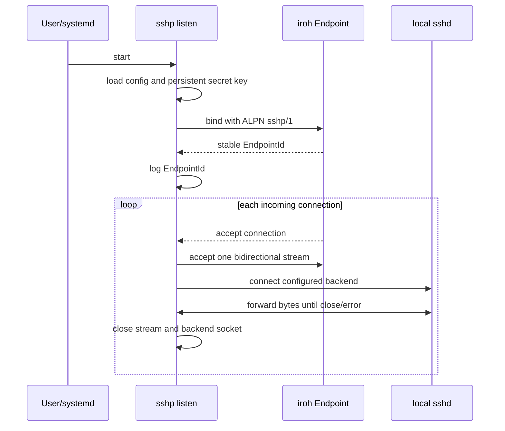
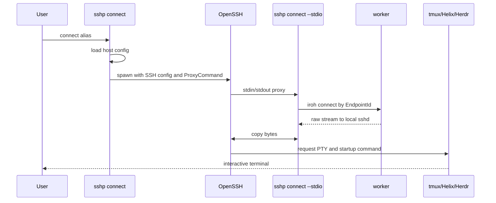
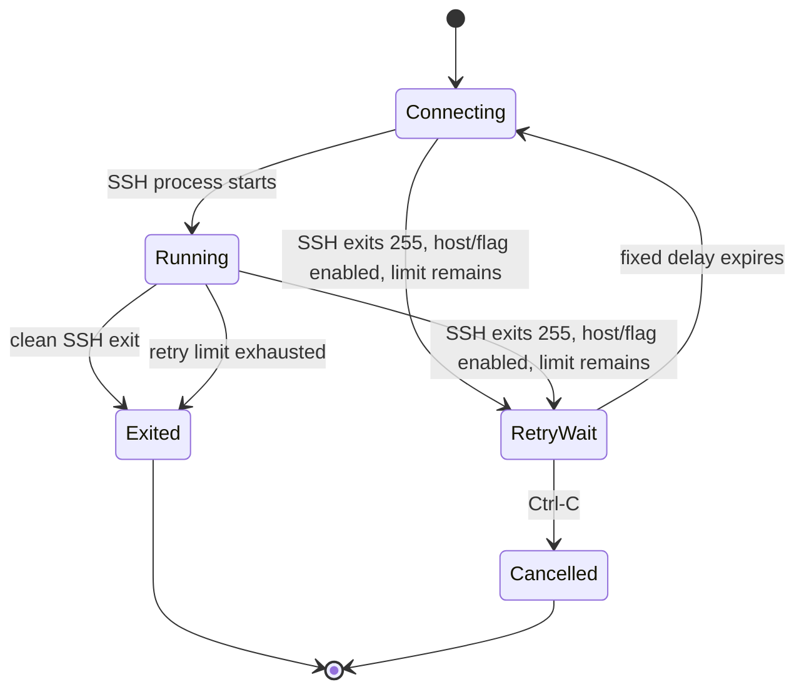

# Activity flows

This document describes implemented runtime behavior. Full network integration
tests remain staged.

## Listen startup



## Interactive connect



## Disconnect and reconnect



Retry uses a fixed delay with a 100 ms minimum, a 60 second cap, and stops
after the configured retry limit (16 reconnect attempts by default, capped at
64). The outer
`sshp` process prints status messages. It must not write status text into the
remote PTY. A persistent startup command such as tmux or Herdr can attach to
its existing workspace; a direct Helix command starts again. Ctrl-C while SSH
runs or while waiting returns exit code 130.

## Systemd installation

```text
sshp listen --install-service
  -> resolve current executable and user config directory
  -> render systemd user unit
  -> write unit atomically
  -> systemctl --user daemon-reload
  -> systemctl --user enable --now sshp-listen
```

Installation is explicit. `sshp listen` alone runs the foreground listener.

## Failure boundaries

| Failure | Owner | Expected result |
| --- | --- | --- |
| Invalid TOML | config loader | fail before network/process start |
| Missing endpoint ID | config loader | actionable config error |
| iroh connect failure | connect mode | retry or return error |
| Local SSH backend unavailable | listen mode | log error and close that peer |
| SSH exit code 255 | connect mode | retry when enabled; OpenSSH does not classify the cause |
| Clean remote exit | connect mode | exit without reconnect |
| systemd unavailable | service installer | return setup error without fake success |
