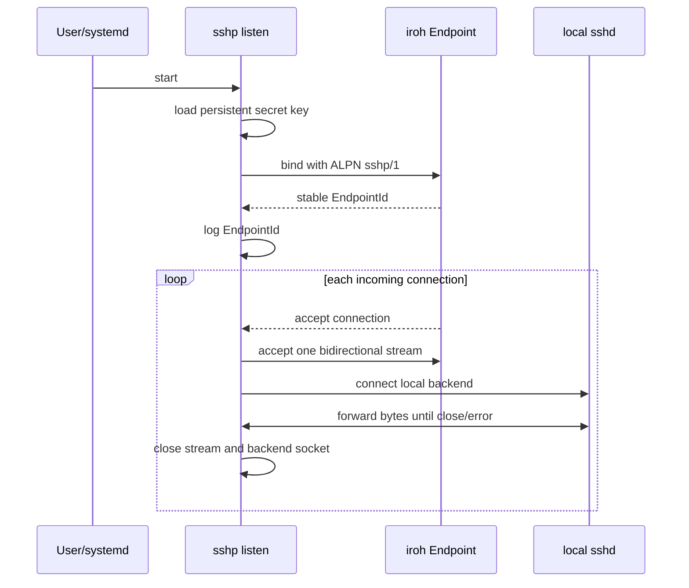
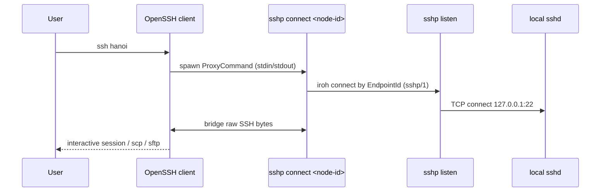

# Activity flows

This document describes implemented runtime behavior. Full network integration
tests remain staged.

## Listen startup



## OpenSSH `ProxyCommand` connect



## OpenSSH config update

```text
sshp config enable <alias> <node-id>
  -> validate alias, endpoint ID, and SSH options
  -> render managed Host block (# BEGIN sshp <alias> ... # END sshp <alias>)
  -> replace existing managed block or append to ~/.ssh/config
  -> write temporary file with 0600 mode and rename atomically
  -> print git-diff unified diff of the modified file

sshp config disable <alias>
  -> comment out ProxyCommand inside # BEGIN sshp <alias> ... # END sshp <alias>
  -> write temporary file with 0600 mode and rename atomically
  -> print git-diff unified diff of the modified file
```

## Endpoint trace

```text
sshp trace <node-id>
  -> bind ephemeral iroh endpoint
  -> measure QUIC handshake time to <node-id> (ALPN sshp/1)
  -> measure bidirectional stream open time
  -> close stream and print latency report to stdout
```

## Systemd installation

```text
sshp config install
  -> resolve current executable and user config directory
  -> render systemd user unit
  -> write unit atomically
  -> systemctl --user daemon-reload
  -> systemctl --user enable --now sshp-listen
  -> print git-diff unified diff of the unit file
```

Installation is explicit. `sshp listen` runs the foreground listener.

## Failure boundaries

| Failure | Owner | Expected result |
| --- | --- | --- |
| Invalid endpoint ID or alias | CLI / config validator | fail before network or file write |
| iroh connect failure | `connect` / `trace` | return descriptive error on `stderr`, exit 1 |
| Local SSH backend unavailable | `listen` | log error and close that peer stream |
| systemd unavailable | service installer | return setup error without fake success |
